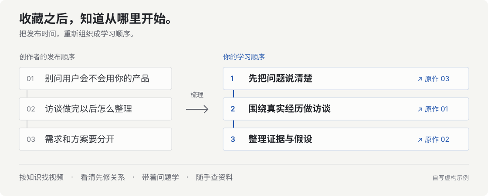
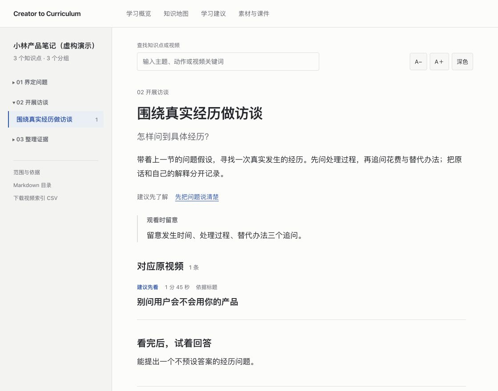
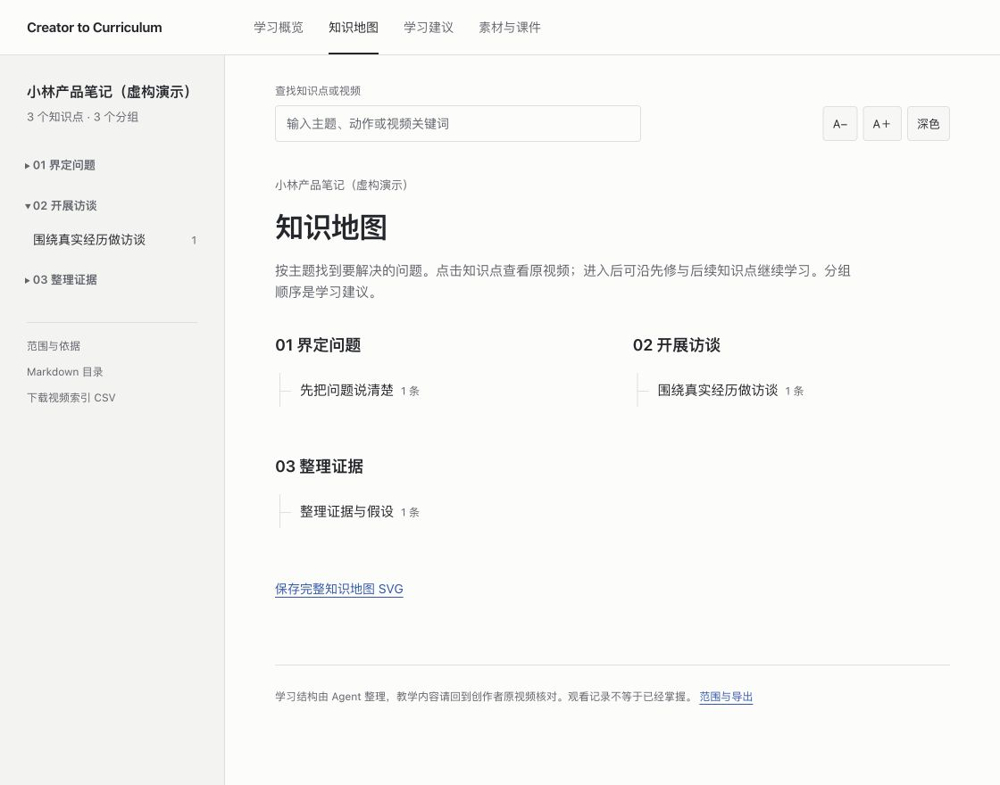
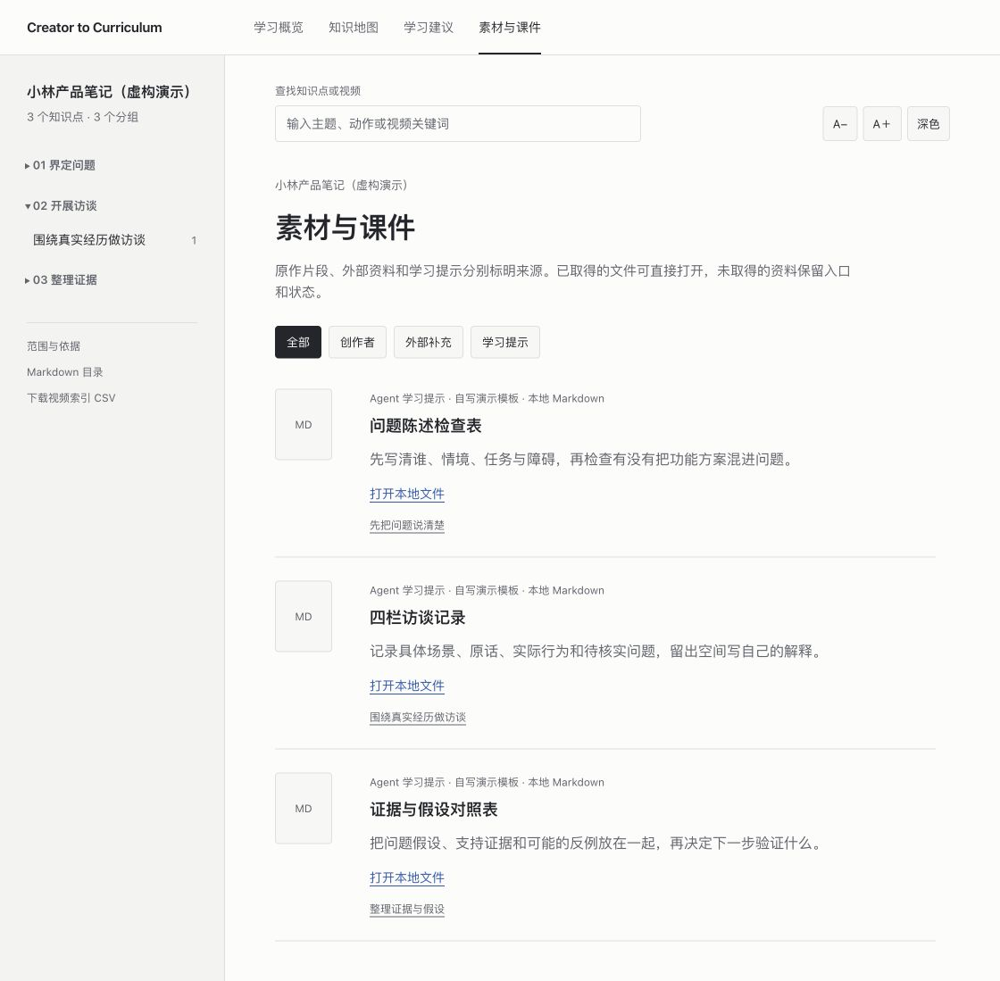

# Creator to Curriculum

**把一位博主的零散视频，整理成你能循序学习的知识地图。**

[](LICENSE)
[](pyproject.toml)
[](https://github.com/cyberpinkman/creator-to-curriculum/actions/workflows/test.yml)

[看实际界面](#效果预览) · [开始使用](#开始使用) · [真实案例](#真实案例) · [常见问题](#常见问题)



你想跟一位博主学英语、健身或编程，却面对几十甚至几百条视频：**从哪条开始？学这个之前要会什么？讲过的知识去哪里找？**

给 Agent 一个账号和学习目标，它会建立作品清单、梳理知识结构、挑选对应原视频，并整理学习建议和资料入口。你沿着地图回到创作者原作学习。

> **当前版本：v0.1 本地工具。** 需要能读写本地文件、运行命令的 AI 助手。演示可独立运行；处理真实账号还需要对应的采集能力。下文列明各平台的支持情况。

## 效果预览

### 围绕一个问题，找到该看的内容

每个知识点都有「解决什么问题」「建议先学什么」「观看时留意什么」和「看完如何自查」。长视频可在补查内容后提供时间定位，方便回到原片段。

[](docs/assets/reader.png)

*截图来自本项目自写的用户访谈演示，由实际阅读器生成。演示不调用模型，不包含真实博主或可播放的原视频。*

| 你想做什么 | 页面会帮你做什么 |
| --- | --- |
| 从头系统学 | 看起步顺序和先修关系，逐步进入知识点 |
| 卡在某个问题 | 搜索主题或视频，找到对应来源与观看重点 |
| 练完再复习 | 对照自查提示，查阅资料、模板与相关原视频 |

<details>
<summary><strong>展开看知识地图与资料页</strong></summary>

**知识地图：** 按学习主题查阅，点击进入知识点，再沿先修与后续关系继续。



**素材与课件：** 区分作者原作、外部参考和 Agent 学习提示；已取得的文件可打开，其余保留来源与状态。



支持手机阅读、深浅色和字号调整。学习结果保存在本地，也可以导出 SVG 地图、Markdown 目录和 CSV 视频索引。

</details>

## 开始使用

### 1. 让 Agent 帮你跑一遍演示

不熟悉命令行也可以先体验。把下面整段复制给**能操作本地文件与终端的 AI 助手**，例如 Codex 或 Claude Code：

```text
请帮我在本地使用 Creator to Curriculum。
仓库：https://github.com/cyberpinkman/creator-to-curriculum

1. 获取项目，阅读 README.md 和 skills/creator-to-curriculum/SKILL.md。
2. 检查 Python 3.11+，运行无需账号和模型调用的 demo-index 演示。
3. 打开生成的学习页面，向我说明知识地图、原视频索引和资料在哪里。
4. 先完成演示，再问我想跟哪位博主学习、我的基础和目标。
```

网页聊天窗口如果不能操作你的电脑，就无法直接执行这段任务。环境安装、Windows / macOS 命令和常见报错，见 [新手指南](docs/getting-started.md)。

### 2. 给它你的博主和学习目标

```text
我想跟这位博主学习：〈账号链接〉
想学会：〈一件具体的事〉
目前基础：〈零基础 / 学过一些 / 已经能做什么〉
每次可用时间：〈例如 30 分钟〉

请先确认采集能力和账号范围，生成精细知识地图、起步路径、
原视频索引、观看重点与学习建议。对关键或模糊的视频补查内容。
公开可取得的资料下载，其余列出入口和状态。
不必全量转写或重编一门课程。记录真实 token 用量和未覆盖的部分。
```

### 3. 打开页面，选一个问题开始

从「学习概览」或「知识地图」进入，查看建议，再打开对应原视频。学习结果默认保存在项目的 `.learning/` 文件夹，Agent 会给出具体入口。

<details>
<summary>我熟悉终端，直接给我命令</summary>

```bash
git clone https://github.com/cyberpinkman/creator-to-curriculum.git
cd creator-to-curriculum
python3 -m creator_curriculum demo-index --out .learning/demo-index
```

用浏览器打开 `.learning/demo-index/index.html`。Windows 可将 `python3` 换成 `py -3`。演示无需模型 API Key，核心运行时没有第三方 Python 依赖。

[全部 CLI 操作](docs/cli.md) · [Agent 技能](skills/creator-to-curriculum/SKILL.md)

</details>

## 真实案例

已经在三个抖音账号上做过本地案例，覆盖语言、健身和编程。以下是 **2026-10-26 的观察范围**；数量不代表所有作品都已观看，也不代表学习效果已经验证。

| 学习方向 | 本次索引范围 | 整理结果 | 内容补查范围 |
| --- | --- | --- | --- |
| 英语雪梨老师 · 自然拼读 | 384 条候选，约 9.43 小时 | 34 个节点 · 9 项资料 | 27 条有转写 / 画面文字引用 |
| 谭成义 · 健身教学 | 159 条目标作者记录，已知约 31.51 小时；7 条时长未知 | 39 个节点 · 11 项资料 | 6 条关键视频，约 78.13 分钟 |
| 英雄编程 · C/C++ 与算法 | 72 条公开作品，约 2.83 小时 | 40 个学习与查阅节点 · 19 项资料 | 8 条关键视频，约 45.31 分钟 |

其余内容按标题与描述归类。日常、经历和宣传内容会单列；资料数量包括文件、在线参考及待取得的资料入口。真实账号数据与私人学习包不随仓库分发。

[查看真实 token 样例、失败尝试与计量范围 →](docs/usage.md)

## 我能用哪些来源？

| 来源 | 当前可用程度 | 开始前需要什么 |
| --- | --- | --- |
| **本地演示** | 可直接体验完整阅读流程 | Python 3.11+；无需平台账号或模型调用 |
| **本地字幕 / 转写** | 已支持带时间戳的 JSON、SRT、VTT | 提供文件，交给 Agent 导入 |
| **抖音** | 三个真实案例已运行 | 已配置的 video-learning 采集服务；本仓库不附带该服务 |
| **YouTube / B 站** | 实验性的账号作品清单适配 | 另装 yt-dlp；本项目尚未完成这两平台的真实账号验收 |

YouTube / B 站尚未内置批量字幕获取和转写。真实平台可能需要登录或受到访问限制；让 Agent 先检查可用能力，再开始采集。[适配说明 →](docs/adapters.md)

## 常见问题

**不会写代码，能用吗？** 主要通过 Agent 操作，你负责给目标和阅读结果。目前仍需要本地环境和采集工具；项目还没有托管网站或一键安装包。建议先跑演示。

**必须把所有视频下载、转写一遍吗？** 不需要。默认先整理作品清单，围绕关键知识与歧义视频补查内容。标题归类和有内容证据的定位会区分标记。

**需要付费吗？** 项目采用 MIT 许可。离线演示不调用模型；真实处理可能使用你的 AI 助手额度、模型 API 或外部服务。是否另需 API Key 取决于执行方式，本项目不强制绑定模型厂商。

**处理一位博主要消耗多少 token？** 取决于读取了多少标题、转写或画面，以及输出和重试。英雄编程案例的 9 次外部 API 调用共 **59,659 token**；这只是该批调用小计，Codex 研究、编排、开发和验证的会话用量另计。[完整范围与对照](docs/usage.md)，不能仅按视频总时长估价。

**课件都能自动下载吗？** Agent 会下载公开可取得的材料。未找到、需要登录或付费的资料保留入口与状态。截图、外部教材和 Agent 模板会说明各自来源。

**整理出来就等于学会了吗？** 学习路线是 Agent 的组织建议，机器转写也可能有误。请回原视频核对，用自己的复述、操作和练习结果判断掌握程度。

## 文档与参与

| 我想…… | 看这里 |
| --- | --- |
| 第一次安装，或运行遇到问题 | [新手指南](docs/getting-started.md) |
| 手动运行命令、接入已有资料 | [CLI 参考](docs/cli.md) · [采集适配](docs/adapters.md) |
| 了解已实现能力与后续计划 | [产品边界](docs/product.md) |
| 记录用量、比较处理规模 | [Token 用量与真实样例](docs/usage.md) |
| 改代码、接入新平台 | [贡献指南](CONTRIBUTING.md) · [数据契约](docs/contracts.md) |
| 反馈问题或提出建议 | [提交 Issue](https://github.com/cyberpinkman/creator-to-curriculum/issues) |

[MIT License](LICENSE) 适用于项目代码、文档和自写演示。第三方视频、字幕与课件保留各自权利。学习资料默认留在本地；所使用的 Agent 或模型服务会按其配置处理输入内容。
